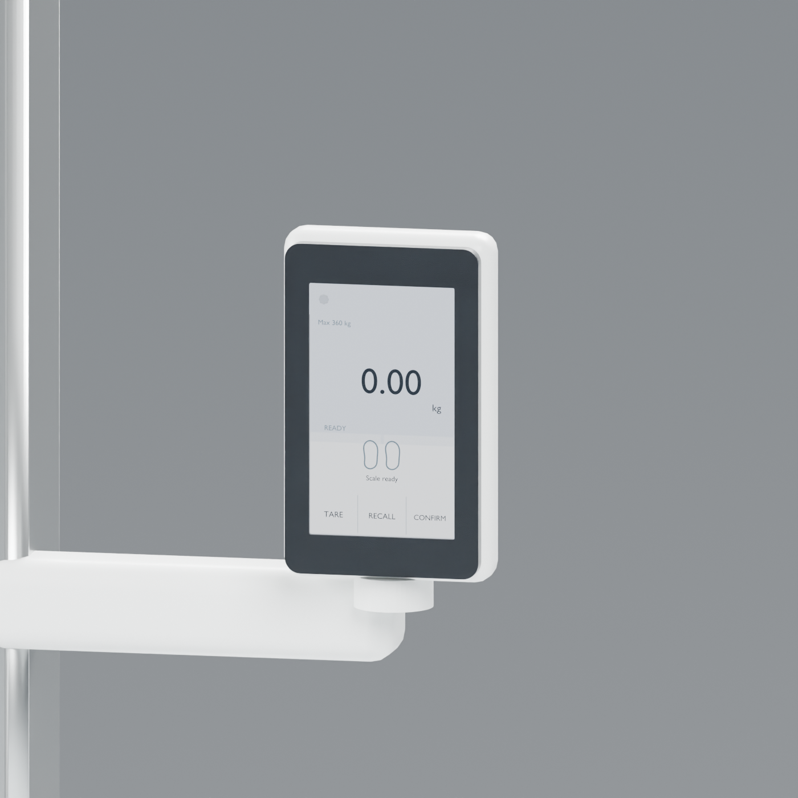
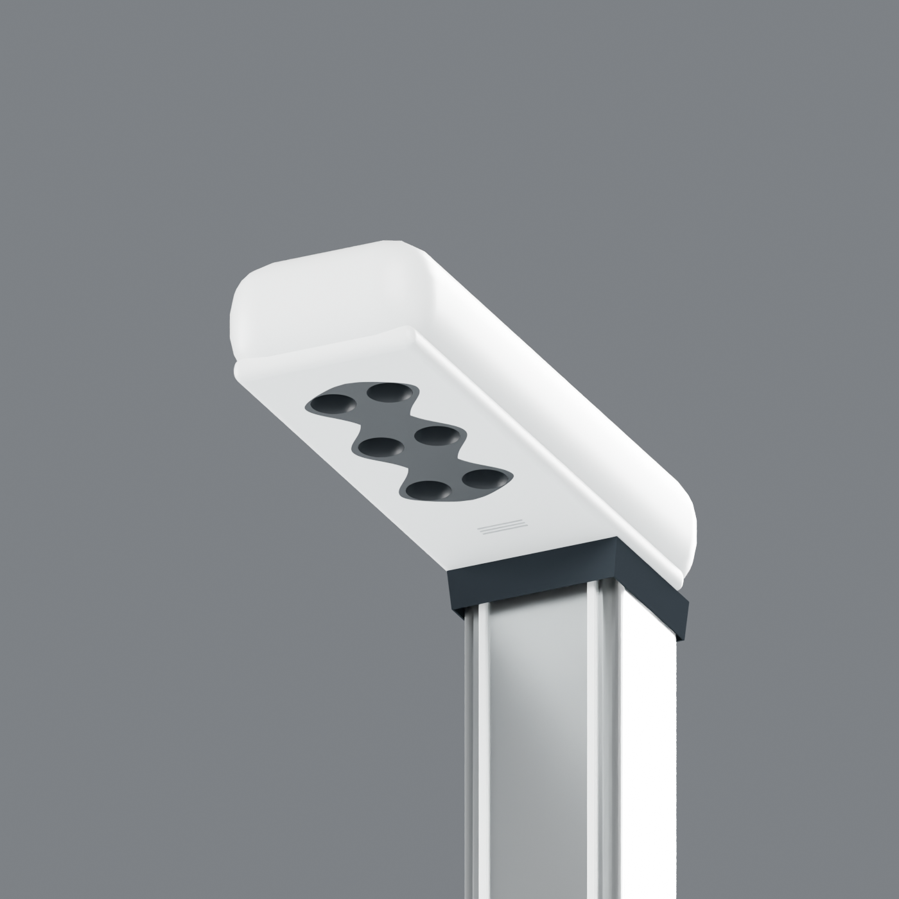
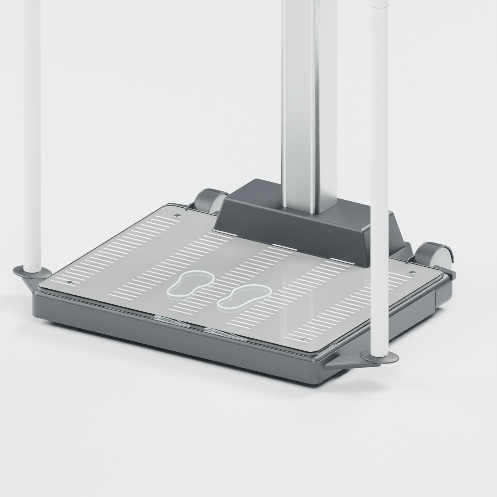

# seca Scale-up Ultra — an interactive Blender study

A measuring station, built to explore. This editable Blender reconstruction brings together the glass platform, handrail, ultrasonic column and ID display of the seca Scale-up Ultra, then adds a set of interactive studies that let you move through the experience of using it.

Change a weight, place a virtual subject beneath the measuring head, try the touchscreen, or tilt and move the station through a scene. The project combines detailed product modeling with approachable simulations of the systems around it—making it as interesting to investigate as it is to render.

*Every image in this repository is a render of the Blender reconstruction.*

## Start exploring

1. Open [`model/seca-scale-up-ultra.blend`](model/seca-scale-up-ultra.blend) in **Blender 5.2.2**.
2. In the **Text Editor**, select the embedded `seca_simulator.py`, inspect it, and choose **Run Script** (**Alt+P**).
3. In the 3D View, open the sidebar (**N**) and choose the **seca study** tab. If the calibration study is not complete, keep the scale unloaded, choose **Start calibration study**, and follow the prompts to confirm the area is clear, scan the empty platform, place the study rod and remove it again.
4. Set a synthetic weight and height, choose **Step on**, wait for the weight to stabilize, then choose **Measure height**. After the measurement, use **Accept height** on the review screen and **Step off** to finish.
5. To interact with the display in the viewport, choose **Enable 3D screen touch** in the sidebar, then press and release a control on the screen; dragging away cancels the press, and **Esc** exits touch mode.

The project opens with editable geometry and materials; running the script brings the interactive study controls to life. Try switching the **Height source** to **Single-ray phantom**, **Six-ray phantom study**, or **Adjustable echo fan study** to see different ways of exploring the height measurement.

## A closer look at the experience

### A touchscreen you can use

The display is built from editable Blender objects, with screen elements and touch regions that move with the display assembly. Explore a guided measurement or the staged self-measurement flow, review a height result, try the tare assistant and mother/child sequence, and open supported settings. Press feedback and drag-to-cancel make it possible to interact with the screen directly in the 3D view.

The study also includes synthetic voice and beeps, standby, fictional patient and user IDs, a mock scanner, and a local mock transfer with success, failure and retry scenarios. These are contained within the Blender study: no real scanner, patient record or network connection is used.

### Height measurement, from rays to a result

The measurement study connects the modeled sensor head, a virtual subject and the platform surface. Choose a numeric height or one of three geometry-based modes:

- **Single-ray phantom** casts a ray from the modeled head toward the phantom and compares the hit with the evaluated platform surface.
- **Six-ray phantom study** casts one ray from each of six modeled openings, combines valid readings in pairs and reports the number of valid pairs and their spread.
- **Adjustable echo fan study** sends a fan of geometric rays from each opening, scores first hits using adjustable study parameters such as reflectivity, angle, distance, attenuation and temperature, and combines the selected readings into a height estimate.

Move or resize the phantom, adjust the study parameters, and use **Sample echo fan** to explore how the result changes. The fan is a geometric approximation for experimentation, not an acoustic wave simulation or a reconstruction of seca's sensor algorithm.

### Weight, setup and movement

The scale study accepts a synthetic gross weight and can apply an adjustable motion signal and filter before reporting a stable reading. Try tare, pre-tare, hold and recall, or switch between weight and height units. A separate calibration sequence provides a way to explore setup before taking a height reading.

The station is built from separate editable parts, including the glass platform and illuminated markings, rail, column, display mount, wheels, feet, rear guard and schematic cables. Move the display, open the column-cover study to look at the modeled cable channel, or use the transport controls to tilt and move the station along an arc. The materials and lighting are set up for product renders, with separate finishes for glass, metal, white surfaces and the darker base.

## Go deeper

Run `seca_simulator.py` first, then run these additional embedded scripts from the Text Editor to open their panels in the **seca study** sidebar:

- **`load_study.py`** explores an idealized four-support load distribution, including a configurable amount of force through the rail, and can apply its synthetic reading to the scale study.
- **`level_study.py`** lets you adjust the feet and an assumed floor tilt, with a visual bubble and displayed roll, pitch and foot gaps.
- **`clearance_study.py`** samples a transport arc against modeled obstacles using conservative proxy envelopes.
- **`display_fit_study.py`** checks selected modeled display surfaces for crossings with the rail, bridge or column at the current pose.

These are exploratory studies with adjustable assumptions. Re-run a check after changing the pose or geometry; a result is not a continuous motion or physical clearance assessment.

## How it was made

The reconstruction was built around the 654 platform, 455 handrail and standard 257 ultrasonic column using published specifications, product images and assembly and operation illustrations. Separate meshes, curves, controls and material nodes keep the model open to inspection and further work. Approximate camera comparisons helped shape the visible parts, while the interface and study scripts connect the modeled components to fictional inputs and results.

This is an independent, reference-informed interpretation rather than manufacturer CAD or firmware. The visual construction, movements, materials and simulated measurements have not been calibrated against a physical unit. For example, the selected v77 reconstruction measured **801 × 582.7 × 2387 mm** in its saved pose; seca publishes **801 × 650 × 2387 mm** for the configured device, and the 67.3 mm depth difference remains unresolved. See [modeling and fidelity](docs/MODELING-AND-FIDELITY.md) and the [source index](docs/SOURCES.md) for the details.

The project is for visualization and exploration, not clinical use. seca and its product names are trademarks of their respective owners; this project is not affiliated with or endorsed by seca. Manufacturer images, manuals and Revit files are linked as references rather than redistributed here.

## Licenses

Original project scripts are offered under the [MIT License](LICENSE); the original model and project-created renders are offered under [CC BY 4.0](licenses/CC-BY-4.0.txt), limited to rights held by their contributors. The packed DejaVu font and synthetic Flite audio retain their [own notices](licenses/). These grants do not license seca trademarks or third-party reference materials; see [NOTICE.md](NOTICE.md).
