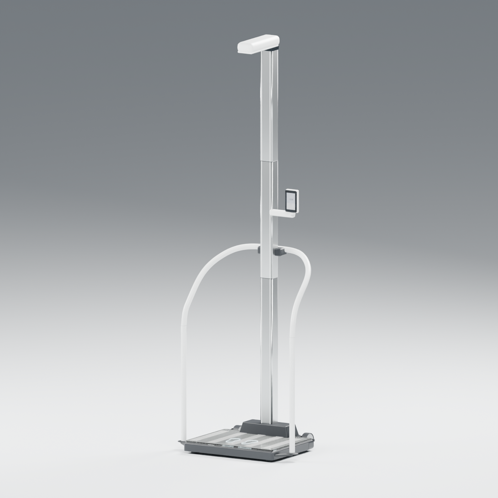

# seca Scale-up Ultra — Blender reconstruction

An editable, reference-informed Blender study of the seca 654 platform, 455 handrail, standard seca 257 ultrasonic column and ID display. The model is intended for visualization and exploratory interaction; it is not manufacturer CAD, seca firmware, a calibrated instrument or an approved clinical simulator.

These are rendered images of the reconstruction, not photographs of the physical device.

## Explore

1. Open [`model/seca-scale-up-ultra.blend`](model/seca-scale-up-ultra.blend) in Blender 5.2.2; the geometry, materials, controls and screen artwork are editable.
2. To use the interactive study, open Blender's **Text Editor**, select the embedded `seca_simulator.py`, inspect it and choose **Run Script** (Alt+P); open the 3D View sidebar (**N**) and select **seca study**.
3. Use the sidebar to try fictional weight and height values, UI states, display adjustments, level setup, and the mock network. No real device, patient data or network is involved.
4. For a current-pose check of selected modeled display surfaces, also run the embedded `display_fit_study.py` and use **Display fit — modeled study**; results are snapshots of selected surface crossings and do not establish physical clearance.

The optional embedded `clearance_study.py`, `level_study.py` and `load_study.py` provide additional approximate studies. See [usage and fidelity](docs/MODELING-AND-FIDELITY.md) for their scope and the evidence behind the model.

| Detail | Render |
| --- | --- |
| Platform and handrail | [View render](images/02-platform.png) |
| Touchscreen | [View render](images/03-touchscreen.png) |
| Ultrasonic head | [View render](images/04-sensor-head.png) |

## Fidelity and source

The model follows publicly available seca images, product specifications and assembly/operation illustrations. The hand-modeled geometry and procedural materials are estimates; the touchscreen and workflow are editable simulations informed by documentation, not a copy of verified firmware. The simulated rays, load, transport, cables and sound are exploratory approximations, not validated measurement or structural physics.

The published assembly dimensions are 801 × 650 × 2387 mm, while the corresponding selected v77 reconstruction measured 801 × 582.7 × 2387 mm in its saved pose. The 67.3 mm depth difference and its front/rear datums remain unresolved. Display pivots and stops, actual materials, internal connections, sensor characteristics, forces and device timing were not measured. [Sources](docs/SOURCES.md) and [modeling notes](docs/MODELING-AND-FIDELITY.md) explain these limits.

seca and product names are trademarks of their respective owners; this independent project is not affiliated with or endorsed by seca. Manufacturer reference images, manuals and Revit files are linked in the documentation and are not redistributed in this repository. The local private research archive contains the collected manufacturer references and retains their notices.

## Licenses

Original project scripts are offered under the [MIT License](LICENSE); original model and project-created renders are offered under [CC BY 4.0](licenses/CC-BY-4.0.txt), limited to rights held by their contributors. These grants do not license seca trademarks or third-party reference materials. The packed DejaVu font and synthetic Flite audio retain their [own notices](licenses/); see [NOTICE.md](NOTICE.md).
